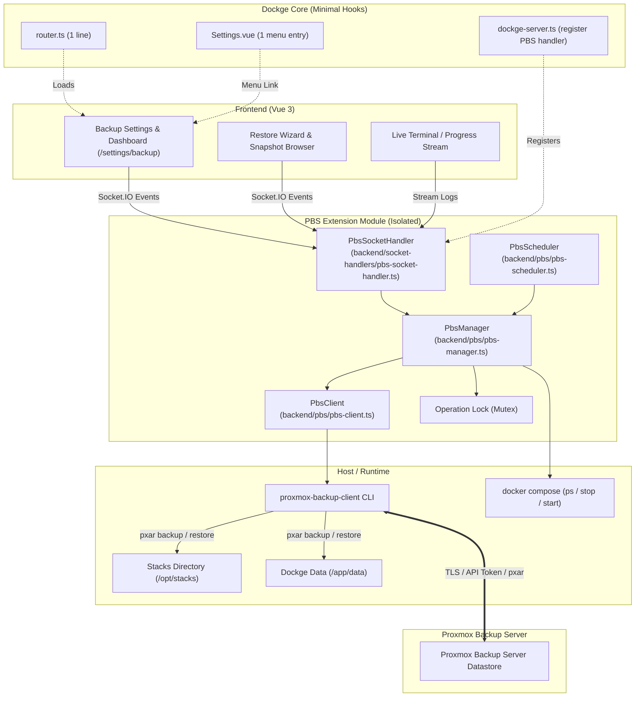
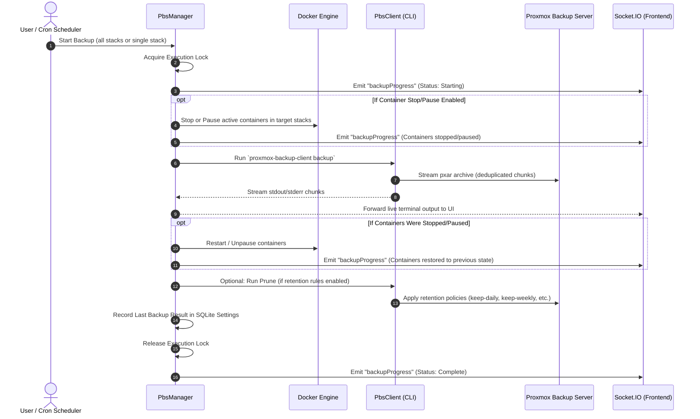
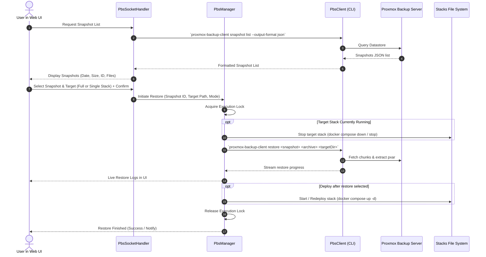
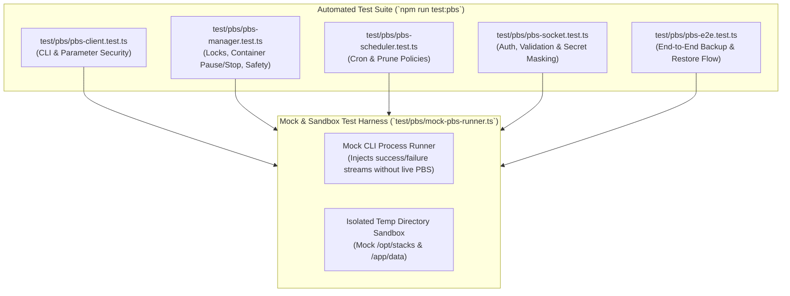
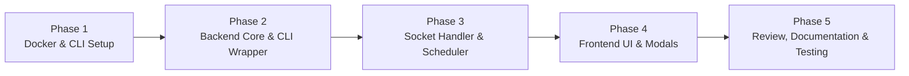

# Proxmox Backup Server (PBS) Integration for Dockge — Implementation Plan

> **Status:** Draft / Architectural Specification  
> **Goal:** Provide seamless, reliable, UI-managed automated and manual backups/restores for all Dockge-managed containers and stacks to Proxmox Backup Server (PBS), while maintaining strict modularity to ensure upstream Dockge rebasing remains frictionless.

---

## 1. Executive Summary & Design Principles

Backups are mission-critical. If backup or restore fails silently or corrupts stack state, data loss occurs. At the same time, Dockge is an actively developed open-source project; modifying existing core files directly will cause merge conflicts whenever rebasing against upstream updates.

### Core Principles
1. **Zero-Invasion Architecture (Rebase-Friendly):**
   - All new backend logic lives inside isolated directories (`backend/pbs/` and `backend/socket-handlers/pbs-socket-handler.ts`).
   - Existing core files (`backend/dockge-server.ts`, `frontend/src/router.ts`, `frontend/src/pages/Settings.vue`) are modified by **at most 2–4 lines each** purely to register the new handler and route.
   - If an upstream rebase touches those files, the diff is trivial to resolve.
2. **Standard-Compliant PBS Client:**
   - Proxmox Backup Server relies on deduplicated, chunked, and client-side encrypted `pxar` (Proxmox File Archive) streams.
   - We utilize the official, high-performance `proxmox-backup-client` CLI via a safe Node.js child process wrapper with structured JSON output and stream progress capture.
3. **Defense in Depth & Data Integrity:**
   - Backups must handle running containers safely (optional pause/stop or non-disruptive live snapshots).
   - Backup scope covers stack compose files (`compose.yaml`), local environment configs (`.env`), stack directories with local bind-mounted data, `global.env`, and optionally Dockge's own database (`dockge.db`).
   - Restore must be non-destructive by default: selective stack restore, dry-run safety verification, and safeguards against overwriting active stacks without confirmation.
4. **Complete UI Management:**
   - PBS configuration & credentials test button.
   - Flexible scheduling via cron expressions with human-friendly presets.
   - Manual backup trigger with real-time log streaming.
   - Snapshot browser with file-level inspection and selective/full restore wizard.

---

## 2. Architecture & System Flow

### 2.1 Architecture Diagram



---

## 3. Data Flow & Execution Workflows

### 3.1 Backup Workflow (Manual or Scheduled)



### 3.2 Restore Workflow (Manual via UI)



---

## 4. File Structure & Changes Overview

To keep rebasing seamless, we follow strict directory boundaries:

### New Files (100% Isolated)
```
backend/
├── pbs/
│   ├── pbs-client.ts        # Child-process wrapper around proxmox-backup-client
│   ├── pbs-manager.ts       # Orchestration (locks, container pause, backup/restore logic)
│   ├── pbs-scheduler.ts     # Cron-based backup trigger using croner
│   └── pbs-types.ts         # TypeScript interfaces & configuration schemas
└── socket-handlers/
    └── pbs-socket-handler.ts # Socket.IO handler for all PBS operations

frontend/src/
├── components/
│   └── settings/
│       └── Backup.vue       # Main Backup & PBS Management View
└── components/
    └── backup/
        ├── PbsConfigCard.vue        # PBS credentials, repository, fingerprint configuration
        ├── PbsScheduleCard.vue      # Schedule cron picker & retention rules
        ├── PbsSnapshotTable.vue     # Interactive list of snapshots from PBS
        ├── PbsRestoreModal.vue      # Guided restore wizard (full vs selective stack)
        └── PbsConsoleModal.vue      # Live terminal modal for backup/restore logs
```

### Modified Files (Minimal Touchpoints)
Only **4 existing files** require small additions:

1. **`backend/dockge-server.ts`** (~4 lines added):
   ```typescript
   // Import PBS handler and scheduler
   import { PbsSocketHandler } from "./socket-handlers/pbs-socket-handler";
   import { pbsScheduler } from "./pbs/pbs-scheduler";
   
   // In DockgeServer constructor / socketHandlerList:
   this.socketHandlerList.push(new PbsSocketHandler());
   
   // In DockgeServer.init():
   await pbsScheduler.init(this);
   ```

2. **`frontend/src/router.ts`** (~2 lines added):
   ```typescript
   const Backup = () => import("./components/settings/Backup.vue");
   // Inside settings children:
   { path: "backup", component: Backup }
   ```

3. **`frontend/src/pages/Settings.vue`** (~3 lines added):
   ```typescript
   // In subMenus computed property:
   backup: {
       title: this.$t("Backup"),
   }
   ```

4. **`docker/Base.Dockerfile`** (~6 lines added):
   - Install `proxmox-backup-client` from the official Proxmox Debian Bookworm repository.

---

## 5. Detailed Component Specifications

### 5.1 PBS Credentials & Connection (`backend/pbs/pbs-types.ts` & `pbs-client.ts`)
* **PBS Repository String:** `[user@realm!]token@host[:port]:datastore`
  - Supports both API tokens (recommended, e.g. `backup-user@pbs!dockge-token`) and standard user accounts (`user@pbs`).
* **Environment Variables used by `proxmox-backup-client`:**
  - `PBS_REPOSITORY`: datastore address and user.
  - `PBS_PASSWORD`: API token secret or user password.
  - `PBS_FINGERPRINT`: SHA-256 TLS cert fingerprint (required for self-signed PBS certs to avoid TLS errors).
  - `PBS_ENCRYPTION_PASSWORD` / `PBS_ENCRYPTION_KEY`: Optional client-side AES-GCM encryption.
* **Storage:**
  - Credentials stored safely in Dockge's SQLite database via existing `Settings.set("pbs_config", ...)` mechanism.
  - Password and encryption keys are masked when returned to the frontend.
* **Connection Test Method:**
  - `pbsClient.testConnection()` runs `proxmox-backup-client status --output-format json` to verify network, certificate, and credentials without altering any data.

### 5.2 Backup Engine (`backend/pbs/pbs-manager.ts`)
* **Backup Scope:**
  1. `stacks.pxar:/path/to/stacksDir` (all Compose stacks, `.env`, and local bind mounts).
  2. `dockge-data.pxar:/app/data` (optional toggle: includes Dockge settings and database for complete disaster recovery).
* **Execution Options:**
  - `stopContainers`:
    - `none` (default, live backup with zero downtime, ideal for stateless containers or bind mounts).
    - `pause` (`docker compose pause` during archive generation).
    - `stop` (`docker compose stop` during archive generation for crash-consistent database volumes).
  - Target Selection:
    - "All Stacks" (entire `stacksDir`).
    - Individual Stack (e.g. only `/opt/stacks/nginx-proxy`).
* **Concurrency Lock (Mutex):**
  - Prevents running multiple backups or a backup and restore simultaneously.
  - Reports current progress state (Idle, Backing Up, Restoring, Pruning) and percentage if available.
* **Live Log Streaming:**
  - Spawns child process with real-time `stdout` and `stderr` piping into a dedicated Socket.IO room so the user can watch the progress live in the Dockge terminal viewer.

### 5.3 Schedule & Retention Engine (`backend/pbs/pbs-scheduler.ts`)
* **Engine:** Built with `croner` (already a direct dependency of Dockge).
* **Schedule Presets:**
  - Daily at midnight (`0 0 * * *`)
  - Weekly on Sunday (`0 2 * * 0`)
  - Hourly or Custom Cron expression (validated via `croner`).
* **Pruning / Retention Integration:**
  - PBS handles deduplication and pruning on the server side.
  - Configurable retention parameters passed to `proxmox-backup-client prune`:
    - `--keep-last <N>`
    - `--keep-daily <N>`
    - `--keep-weekly <N>`
    - `--keep-monthly <N>`

### 5.4 Restore Engine (`backend/pbs/pbs-manager.ts` & `PbsRestoreModal.vue`)
* **Snapshot Browser:**
  - Lists all available snapshots from PBS: timestamp, backup ID, backup type (`host`), archive contents (`stacks.pxar`, `dockge-data.pxar`), and snapshot size.
* **Restore Modes:**
  1. **Full Stacks Restore:**
     - Extracts `stacks.pxar` into `stacksDir`.
     - Optional safety prompt: "Create pre-restore backup of current stacks directory before overwriting".
  2. **Single Stack Restore:**
     - Extracts only the specified stack directory from the archive.
     - Option to restore as a new stack name (e.g. `<stack>-restored`) or overwrite the existing stack.
  3. **Dockge Configuration Restore:**
     - Option to restore `/app/data/dockge.db` (requires application restart notification).
* **Post-Restore Actions:**
  - Automatically refreshes Dockge stack list (`server.sendStackList()`).
  - Option to auto-start restored stacks (`docker compose up -d`).

### 5.5 UI Components (`frontend/src/components/settings/Backup.vue`)
Organized cleanly into tabbed or card-based views within the Dockge Settings area:
1. **Status & Actions Bar:** Current status (Idle / Running), last backup time, next scheduled run, and "Backup Now" button.
2. **Configuration Card:** PBS Host, Port, Datastore, Auth Realm, Username/Token ID, Secret, Fingerprint, and "Test Connection" button.
3. **Schedule & Retention Card:** Enable/Disable toggle, Cron selector (Daily, Weekly, Custom), Retention numbers.
4. **Snapshots & Restore Table:** Searchable table of past backups on PBS, with "Inspect Files", "Restore Stack", and "Restore All" actions.
5. **Live Console Modal:** Embedded terminal window (reusing Dockge's terminal/xterm style) to view real-time backup/restore logs.

---

## 6. Security, Safety & Error Handling

| Risk / Failure Point | Mitigation Strategy |
| :--- | :--- |
| **Concurrent Backups** | Backend in-memory lock ensures only one backup or restore runs at any time. Sockets reject secondary runs with descriptive error. |
| **Untrusted TLS Certs** | `PBS_FINGERPRINT` is supported and validated, allowing secure connections to self-signed PBS nodes without disabling TLS verification. |
| **Credential Leakage** | `PBS_PASSWORD` is injected via child process environment variables, never written to command line strings or temporary disk files. The UI masks secrets. |
| **Corrupted Restore** | Validation verifies snapshot manifest integrity before starting extraction. Single stack restore option avoids touching unrelated stacks. |
| **Process Interruption** | Signal handlers clean up temporary extraction folders and guarantee paused/stopped containers are unpaused/started on failure or SIGINT. |
| **Missing CLI Binary** | Backend checks for `proxmox-backup-client` availability on startup; if missing, UI displays a clear guidance banner with installation instructions rather than crashing. |

---

## 7. Developer Testing Setup & Automated Test Strategy

Backups are critical infrastructure. Silent failures, race conditions, or flawed restore routines cannot be tolerated. To ensure all critical paths are rigorously verified without imposing brittle external testing frameworks or merge-conflict-heavy dependencies, we implement an automated test suite based on **Node.js's native test runner (`node:test`) and assertion engine (`node:assert/strict`)**, executed directly through Dockge's existing `tsx` runner.

### 7.1 Testing Architecture & Harness



### 7.2 Automated Test Coverage Matrix

| Test Suite | Target Component | Critical Invariants & Edge Cases Verified |
| :--- | :--- | :--- |
| **`pbs-client.test.ts`** | `PbsClient` | • Environment variable injection (`PBS_REPOSITORY`, `PBS_PASSWORD`, `PBS_FINGERPRINT`).<br/>• **Credential Safety**: Confirms passwords/secrets are NEVER passed as CLI arguments (which would be exposed via `ps aux`).<br/>• Output parsing: parses JSON snapshot arrays, empty states, and handles malformed CLI output gracefully.<br/>• TLS certificate fingerprint verification logic.<br/>• Custom error formatting: translates CLI stderr exit codes into clear, actionable `PbsClientError` messages. |
| **`pbs-manager.test.ts`** | `PbsManager` | • **Concurrency Mutex Lock**: Calling `startBackup()` or `startRestore()` while another operation is in progress immediately throws a locked error.<br/>• **Container State Lifecycle**: When container pause/stop is requested, verifies `docker compose pause/stop` is executed before backup, and `unpause/start` is executed after.<br/>• **Crash Recovery Guarantee**: Verifies that even if the backup command crashes or throws an exception, paused/stopped containers are ALWAYS resumed (`try ... finally`).<br/>• **Path Traversal Protection**: Rejects stack names containing malicious characters (`../`, `/`, `\`) to prevent directory traversal outside `stacksDir`. |
| **`pbs-scheduler.test.ts`** | `PbsScheduler` | • Validates cron string patterns (Daily, Weekly, Custom) against `croner`.<br/>• Ensures schedule gracefully skips execution if PBS configuration is incomplete or disabled.<br/>• Verifies correct generation of PBS prune arguments (`--keep-daily`, `--keep-weekly`, etc.). |
| **`pbs-socket.test.ts`** | `PbsSocketHandler` | • **Authentication Enforcement**: Every PBS socket event rejects unauthenticated calls with an unauthorized error.<br/>• **Secret Masking**: `getPbsConfig` masks existing passwords as `********`. Saving settings without re-entering the password preserves the stored secret without overwriting it with asterisks. |
| **`pbs-e2e.test.ts`** | Full System Integration | • Creates real temporary stack directories with `compose.yaml` and `.env`.<br/>• Simulates full backup, snapshot extraction, and file restore.<br/>• Verifies restored stack files match originals byte-for-byte with identical permissions. |

### 7.3 Dev & CI Execution Workflow

Developers and reviewers can run the full automated test suite with a single command without needing a live Proxmox Backup Server instance:
```bash
# Run all automated PBS unit and integration tests:
npm run test:pbs
# Or directly with tsx:
npx tsx --test test/pbs/*.test.ts
```

For staging environments connected to a real PBS instance, optional live testing can be enabled by setting environment variables:
```bash
PBS_TEST_LIVE=1 \
PBS_TEST_REPOSITORY="backup@pbs!token@192.168.1.50:8007:datastore" \
PBS_TEST_PASSWORD="secret-token-key" \
PBS_TEST_FINGERPRINT="aa:bb:cc..." \
npm run test:pbs
```

---

## 8. Step-by-Step Implementation Phases



### Phase 1: Environment & CLI Integration
1. Update `docker/Base.Dockerfile`:
   - Add Proxmox PBS Client apt repository keyring and source list:
     ```dockerfile
     # Proxmox Backup Client repository for Bookworm
     RUN curl -fsSL https://enterprise.proxmox.com/debian/proxmox-release-bookworm.gpg -o /etc/apt/trusted.gpg.d/proxmox-release-bookworm.gpg \
         && echo "deb http://download.proxmox.com/debian/pbs-client bookworm main" > /etc/apt/sources.list.d/pbs-client.list \
         && apt update && apt install --yes --no-install-recommends proxmox-backup-client \
         && rm -rf /var/lib/apt/lists/*
     ```
2. Verify local fallback handling when running outside Docker.

### Phase 2: PBS Backend Client & Core Engine
1. Implement `backend/pbs/pbs-types.ts`: Define all configuration, snapshot, and event interfaces.
2. Implement `backend/pbs/pbs-client.ts`:
   - Safe execution of `proxmox-backup-client` with environment variable injection.
   - Methods: `status()`, `backup()`, `snapshotList()`, `snapshotFiles()`, `restore()`, `prune()`.
3. Implement `backend/pbs/pbs-manager.ts`:
   - Locking mechanism.
   - Stacks discovery and target directory packaging.
   - Container pause/stop & resume integration.
   - Log streaming event emitter.

### Phase 3: Scheduler & Socket Handler
1. Implement `backend/pbs/pbs-scheduler.ts`:
   - Load schedule settings from SQLite database.
   - Setup `croner` job.
   - Automatic execution of backup + retention prune.
2. Implement `backend/socket-handlers/pbs-socket-handler.ts`:
   - Socket events: `getPbsConfig`, `savePbsConfig`, `testPbsConnection`, `startPbsBackup`, `getPbsSnapshots`, `startPbsRestore`, `getPbsSchedule`, `savePbsSchedule`.
   - Ensure proper authentication check (`checkLogin(socket)`) on all handlers.
3. Hook into `backend/dockge-server.ts` (the only backend modification, 4 lines).

### Phase 4: Frontend UI
1. Create `frontend/src/components/settings/Backup.vue`:
   - Sub-cards: Connection Settings, Schedule & Retention, Snapshots Table.
2. Create `frontend/src/components/backup/PbsRestoreModal.vue`:
   - Target selection (All Stacks vs Selected Stack).
   - Confirmation dialog to avoid accidental overwrites.
3. Create `frontend/src/components/backup/PbsConsoleModal.vue`:
   - Real-time terminal output during manual backup or restore.
4. Hook route into `frontend/src/router.ts` and menu into `frontend/src/pages/Settings.vue`.
5. Add localized strings to `frontend/src/lang/en.json`.

### Phase 5: Testing, Hardening & Verification
1. **Connection Testing:** Validate token auth, user/password auth, invalid fingerprints, and connection timeouts.
2. **Backup Testing:** Validate backup of single stack, multi-container stacks, stacks with bind mount data, and `global.env`.
3. **Restore Testing:** Validate full restore, selective stack restore into existing directory, and restore into a renamed staging folder.
4. **Schedule Verification:** Verify cron triggers, error logging on network disconnect, and prune rules.
5. **Rebase Dry-Run:** Perform a simulated git rebase to verify clean merges with zero upstream conflicts.

---

## 9. Summary of Rebase Feasibility

By strictly isolating the feature into independent modules, the footprint on Dockge's repository is negligible:
- **Core files touched:** 4 files (`dockge-server.ts`, `router.ts`, `Settings.vue`, `Base.Dockerfile`).
- **Total lines changed in core files:** < 20 lines.
- **Risk to standard Dockge functionality:** Zero (all PBS routines run in separate classes and socket namespaces; if PBS is unconfigured, zero overhead or background tasks are spawned).

